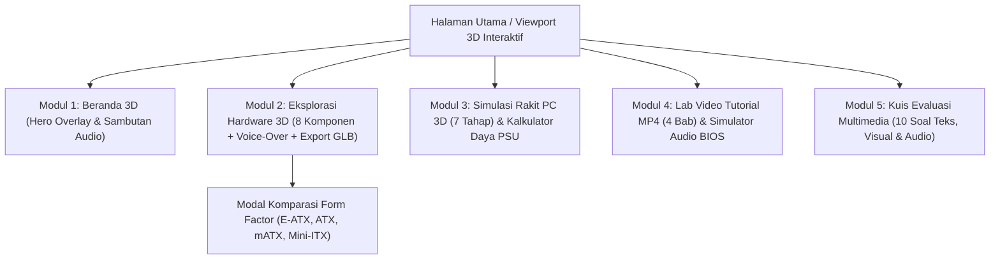

# DOKUMEN PERANCANGAN & STORYBOARD PRODUK MULTIMEDIA INTERAKTIF
**Judul Produk:** PC Builder 101 — Media Pembelajaran Interaktif 3D Pengenalan & Perakitan Hardware Komputer  
**Mata Kuliah:** Sistem Multimedia (3 SKS)  
**Program Studi / Semester:** S1 Ilmu Komputer / Semester VII-A  
**Fakultas:** Teknik  
**Dosen Pengampu:** Melati Rosanensi, M.Kom  
**Bentuk Ujian:** Project-Based Assessment (Kelompok — 10 Mahasiswa)  
**Link Demo Website:** [https://pcbuilder-opal.vercel.app](https://pcbuilder-opal.vercel.app)  
**Repositori GitHub:** [https://github.com/Fanndev/3D-PC-Builder](https://github.com/Fanndev/3D-PC-Builder)

---

## DAFTAR ANGGOTA KELOMPOK

| No | Nama Mahasiswa | NIM |
| :---: | :--- | :--- |
| 1 | Muh. Farid Hakim | `2301010211` |
| 2 | Mauulana Habib Al Ansyori | `2301010197` |
| 3 | Mohamad Irfan fadhlurrahman | `2301010162` |
| 4 | Mohammad Syahiddin Danuwarsi Abdussamas | `2301010174` |
| 5 | Arya Ramadhani | `2301010208` |
| 6 | Nabila Umardi | `2301010165` |
| 7 | Muhammad Ferris Naufal | `2301010174` |
| 8 | Muhammad Qodri | `2301010172` |
| 9 | Mu'taman Abid | `2301010189` |
| 10 | Reno Kurniawan | `2301010175` |

---

## BAB 1: ANALISIS KEBUTUHAN PENGGUNA & TUJUAN PRODUK

### 1.1 Analisis Permasalahan & Kebutuhan Pengguna
Dalam pembelajaran perangkat keras komputer (*Computer Hardware & Assembly*), siswa maupun mahasiswa sering mengalami kendala berikut:
1. **Keterbatasan Akses Perangkat Fisik:** Komponen komputer modern (seperti *Motherboard ATX Z790*, prosesor *Intel Core i7/i9 LGA 1700*, *RAM DDR5*, *SSD NVMe M.2*, dan *Kartu Grafis GeForce RTX*) memiliki harga yang tinggi dan rentan rusak (pin socket bengkok atau korsleting listrik statis) apabila dibongkar-pasang berulang kali tanpa pemahaman dasar.
2. **Kesulitan Memahami Struktur Ruang 3D & Letak Slot:** Media buku teks 2D statis sulit menggambarkan posisi spasial antar-slot pada motherboard (seperti perbedaan slot RAM *Dual-Channel A2/B2*, posisi *M.2 Shield Frozr*, atau jalur *PCIe 5.0 x16*).
3. **Kurangnya Pemahaman Diagnosa Suara (*BIOS Beep Codes*):** Banyak pengguna tidak memahami arti kode bunyi *beep* pada speaker motherboard ketika PC gagal menyala (*POST Error*).

### 1.2 Target Pengguna
* Mahasiswa tingkat awal jurusan Ilmu Komputer / Teknik Informatika / Sistem Informasi.
* Siswa SMK jurusan Teknik Komputer dan Jaringan (TKJ) / Rekayasa Perangkat Lunak.
* Masyarakat umum yang ingin belajar merakit komputer secara mandiri dan aman.

### 1.3 Tujuan Produk Multimedia
1. Menyediakan **laboratorium virtual 3D interaktif berbasis web (Three.js)** yang memungkinkan pengguna memutar 360°, membedah lapisan komponen (*Exploded View*), dan menginspeksi 8 komponen utama PC secara aman.
2. Mengintegrasikan **5 elemen multimedia secara utuh** (Teks, Gambar/Grafis 3D & SVG, Audio Voice-Over & BIOS Beep Synthesizer, Video Praktik Perakitan HD, serta Animasi/Simulasi Interaktif).
3. Membimbing pengguna memahami urutan perakitan PC dari nol hingga menyala (*First Boot*), menghitung estimasi kebutuhan daya *Power Supply (PSU)*, serta menguji pemahaman melalui kuis evaluasi berbasis multimedia.

---

## BAB 2: KONSEP PRODUK MULTIMEDIA

### 2.1 Identitas & Konsep Aplikasi
* **Nama Produk:** PC Builder 101 — 3D Interactive Multimedia Studio
* **Bentuk Produk:** Aplikasi Web Interaktif 3D (*Web-Based Interactive Multimedia*)
* **Tema:** Media Pembelajaran Interaktif untuk Siswa/Mahasiswa
* **Teknologi & Tools Pengembangan:**
  * **3D Engine & Animasi:** Three.js (WebGL), Blender 3D (`.blend` & `.glb`), HTML5 Canvas 2D
  * **Audio Engine:** Web Audio API Synthesizer, Real-Time Oscilloscope Analyser, FFmpeg Audio Processing, Narasi Voice-Over Bahasa Indonesia (`.mp3`)
  * **Video Processing:** FFmpeg Video Compositing (H.264 `.mp4` 720p 30fps dengan sinkronisasi narasi per adegan)
  * **Antarmuka (UI/UX):** HTML5, CSS3 *Cyber-Studio Glassmorphism*, JavaScript ES6+

### 2.2 Integrasi 5 Komponen Multimedia di Dalam Produk
| Komponen Multimedia | Implementasi Nyata di Dalam "PC Builder 101" |
| :--- | :--- |
| **1. Teks** | Materi tersegmentasi (Deskripsi, Cara Kerja, Spesifikasi Teknis, Tips K3) untuk 8 komponen utama, tabel komparasi *Form Factor Motherboard* (E-ATX, ATX, mATX, Mini-ITX), tabel diagnosa *BIOS Beep Codes*, serta 10 soal kuis & pembahasan. |
| **2. Gambar / Grafis** | Model 3D PBR 8 komponen PC (termasuk detail *MSI MPG Z790 CARBON WIFI*), ikon vektor SVG per komponen, tekstur jalur sirkuit PCB 1024x1024, dan diagram perbandingan dimensi fisik *Form Factor*. |
| **3. Audio** | **31 file audio MP3** mencakup: 9 *Voice-Over* komponen & sambutan, 7 *Voice-Over* panduan langkah simulasi rakit, 4 *Voice-Over* bab video, 5 audio kode *Beep* BIOS + visualisasi gelombang *Live Oscilloscope*, 5 efek suara klik/interaksi (*SFX*), dan musik latar elektronik ambient (*BGM*). |
| **4. Video** | **5 file video MP4 HD (1280x720)** yang memadukan rekaman fisik pemasangan komponen PC asli dengan sulih suara (*Voice-Over*) Bahasa Indonesia yang tersinkronisasi per detik adegan (Bab 1 s/d Bab 4 + Video Lengkap). |
| **5. Animasi & Interaktivitas** | Animasi *Mode Bedah 3D (Exploded View)*, animasi *Camera Fly-To* saat memilih komponen, animasi buka-tutup kaca casing, animasi putaran kipas & pergantian tema lampu RGB, animasi terbang pemasangan komponen pada **Simulasi Rakit PC 3D**, serta **Simulasi Animasi 2D**. |

---

## BAB 3: DESAIN PRODUK (STRUKTUR NAVIGASI, LAYOUT & STORYBOARD)

### 3.1 Struktur Navigasi
Produk ini menggunakan **Struktur Navigasi Campuran (*Composite / Non-Linear Navigation*)** melalui kapsul navigasi melayang (*Floating Island Navigation*) di bagian atas layar, sehingga pengguna bebas berpindah antar-modul kapan saja:



### 3.2 Rancangan Layout Antarmuka (Wireframe Layout)
Antarmuka dirancang dengan konsep **Non-Intrusive Glass HUD** di mana kanvas 3D Three.js memenuhi 100% latar belakang layar, sedangkan panel informasi menggunakan efek kaca transparan (*backdrop-filter: blur*) di sisi kiri dan kanan:

```text
+-----------------------------------------------------------------------------------+
| [Logo: PC BUILDER 101]     ( Beranda | Eksplorasi 3D | Simulasi | Video | Kuis )  [⚙️ Alat] |
+-----------------------------------------------------------------------------------+
| +-----------------------+                               +-----------------------+ |
| | PANEL KIRI (Glass UI) |                               | PANEL KANAN (Glass UI)| |
| |                       |       RUANG 3D INTERAKTIF     |                       | |
| | - Daftar 8 Komponen   |         (Three.js WebGL)      | - Kartu Visual & SVG  | |
| |   atau                |                               | - Tab: Materi / Spek  | |
| | - 7 Langkah Rakit 3D  |     [Pin 01]    [Pin 04]      | - Tombol Voice-Over   | |
| |   atau                |          [Objek PC 3D]        | - Kalkulator Daya PSU | |
| | - Simulator Beep BIOS |     [Pin 06]    [Pin 07]      | - Player Video MP4 HD | |
| +-----------------------+                               +-----------------------+ |
|                                                                                   |
|          ( 💥 Bedah 3D | 🪟 Buka Kaca | 🌈 RGB | ⚡ Daya: ON | 📌 Pin | 👁️ Bersih | 🎯 Reset ) |
+-----------------------------------------------------------------------------------+
```

### 3.3 Tabel Storyboard Produk Multimedia Interaktif

| Scene / Modul | Visual & Objek 3D | Teks yang Ditampilkan | Audio yang Diputar | Video & Animasi / Interaktivitas |
| :--- | :--- | :--- | :--- | :--- |
| **Scene 1: Beranda 3D (`#view-home`)** | Kanvas 3D menampilkan Rig PC Gaming/Workstation utuh dengan lampu ARGB menyala dan kipas berputar; Panel Hero di sisi kiri. | Judul *"Eksplorasi & Rakit Perangkat Keras PC dalam Ruang 3D"*, badge 5 komponen multimedia, dan statistik ringkas (8 Part, 5 Kode BIOS, 360° Orbit). | `vo_welcome.mp3` (saat tombol Sambutan Audio diklik), `bgm_ambient.mp3` (opsional), dan `sfx_click.mp3`. | Animasi putaran kipas 3D real-time, orbit kamera 360°, tombol pintas menuju *Eksplorasi 3D* dan *Simulasi Rakit PC*. |
| **Scene 2: Eksplorasi Hardware 3D (`#view-explore`)** | Panel kiri berisi daftar 8 komponen; Tengah menampilkan model 3D dengan 8 *Floating Pin*; Panel kanan menampilkan detail komponen terpilih. | Nama & model komponen (misal: *MSI MPG Z790 CARBON WIFI*), 3 tab bacaan (*Materi & Fungsi*, *Spesifikasi & 3D*, *Panduan Pasang*), serta modal *Komparasi Form Factor*. | `vo_mobo.mp3` s/d `vo_case.mp3` sesuai komponen yang dipilih pengguna, serta `sfx_click.mp3`. | **Camera Fly-To** otomatis mendekati komponen yang diklik, **Mode Bedah 3D (*Exploded View*)**, buka-tutup kaca casing, ganti 5 tema RGB, dan unduh file `.GLB`. |
| **Scene 3: Simulasi Rakit PC 3D & Kalkulator PSU (`#view-simulate`)** | Casing 3D dimulai dalam keadaan kosong; Panel kiri menampilkan 7 urutan langkah perakitan; Panel kanan menampilkan Kalkulator Daya PSU. | Instruksi 7 langkah merakit PC secara berurutan, *progress bar* persentase perakitan, dan pilihan komponen pada Kalkulator PSU beserta rekomendasi Watt. | `vo_step1.mp3` s/d `vo_step7.mp3` (panduan suara tiap langkah), `sfx_install_ok.mp3`, `sfx_error.mp3` (jika salah urutan), dan `playPowerOnBoot()` saat selesai. | Animasi komponen 3D terbang dari luar masuk ke slot motherboard satu per satu; Kalkulator menghitung total beban Watt dan rekomendasi PSU *80+ Gold* secara otomatis. |
| **Scene 4: Lab Video Tutorial & Audio BIOS (`#view-lab`)** | Panel kiri: *Live Audio Oscilloscope* & 5 kartu Kode Beep BIOS; Panel kanan: Pemutar Video MP4 HD, kanvas Simulasi 2D, dan 4 tombol Bab Video. | Penjelasan pola bunyi *beep* BIOS, status kerusakan, dan solusinya; Ringkasan materi Bab 1 s/d Bab 4 perakitan PC. | `beep_normal.mp3`, `beep_ram_error.mp3`, `beep_vga_error.mp3`, `beep_cpu_overheat.mp3`, `beep_power_error.mp3`, serta `vo_chap1.mp3` s/d `vo_chap4.mp3`. | Pemutaran **5 Video MP4 HD (720p)** (`bab1_cpu_mobo.mp4` s/d `bab4_gpu_psu_boot.mp4` & `tutorial_rakit_pc.mp4`) yang tersinkronisasi per adegan + gelombang *Oscilloscope* real-time. |
| **Scene 5: Kuis Evaluasi Multimedia (`#view-quiz`)** | Panel kuis interaktif di tengah layar dengan indikator nomor soal, skor *real-time*, 4 tombol pilihan ganda (A/B/C/D), dan kotak pembahasan. | 10 pertanyaan evaluasi mencakup konsep fungsi *hardware*, prosedur pemasangan aman, perhitungan daya PSU, dan diagnosa bunyi BIOS. | Audio kode *beep* BIOS pada soal bertipe `[SOAL AUDIO]`, `sfx_quiz_correct.mp3` saat benar, dan `sfx_quiz_wrong.mp3` saat salah. | Validasi jawaban instan dengan warna indikator hijau/merah, penjelasan pembahasan di setiap soal, serta rekapitulasi nilai akhir & predikat kompetensi. |

---

## BAB 4: PENGUJIAN PENGGUNA (BLACK-BOX & USER TESTING)

Pengujian fungsionalitas dilakukan pada seluruh modul untuk memastikan produk multimedia interaktif berjalan baik dan bebas kendala:

| No | Modul / Fitur yang Diuji | Skenario Pengujian | Hasil yang Diharapkan | Status |
| :---: | :--- | :--- | :--- | :---: |
| 1 | **Viewport 3D & OrbitControls** | Memutar, memperbesar (*zoom*), dan mengklik objek 3D secara langsung di kanvas. | Kamera berputar halus 60 FPS dan terbang menuju komponen yang diklik (*Camera Fly-To*). | **Valid / Berhasil** |
| 2 | **Mode Bedah 3D (*Exploded View*) & Kaca Casing** | Mengklik tombol `💥 Bedah 3D` dan `🪟 Buka Kaca` pada HUD bawah. | Kaca samping casing membuka secara berengsel dan 8 komponen 3D memisahkan diri di udara. | **Valid / Berhasil** |
| 3 | **Narasi Suara (*Voice-Over* Bahasa Indonesia)** | Mengklik tombol `🔊 Dengarkan Voice-Over` di Beranda, 8 Komponen, dan 7 Langkah Rakit. | File audio `.mp3` Bahasa Indonesia berputar jernih dan tombol berubah menjadi `⏹️ Hentikan Suara`. | **Valid / Berhasil** |
| 4 | **Simulasi Rakit PC 3D & Validasi Urutan** | Mencoba memasang komponen secara acak, lalu memasang sesuai urutan Langkah 1 s/d 7. | Sistem menolak urutan yang salah dengan peringatan suara, dan menganimasikan komponen masuk ke slot jika urutan benar. | **Valid / Berhasil** |
| 5 | **Simulator Audio BIOS & Oscilloscope** | Mengklik tombol `🔊 Putar Beep` pada kelima kartu kode diagnosa BIOS. | Terdengar pola bunyi *beep* sesuai frekuensi motherboard disertai gelombang *oscilloscope* bergerak aktif. | **Valid / Berhasil** |
| 6 | **Pemutar Video Tutorial MP4 Per Bab** | Memilih Bab 1, Bab 2, Bab 3, Bab 4, dan tombol `🎬 Putar Full Video`. | Video `.mp4` 720p berputar lancar dengan visual dan narasi suara Bahasa Indonesia yang sinkron di setiap adegan. | **Valid / Berhasil** |
| 7 | **Kuis Evaluasi Interaktif 10 Soal** | Menjawab 10 soal (termasuk soal tebak bunyi BIOS) hingga halaman skor akhir. | Skor dihitung akurat (0–100), pembahasan tampil di tiap soal, dan predikat akhir muncul dengan benar. | **Valid / Berhasil** |
| 8 | **Ekspor & Impor Model 3D (`.GLB`)** | Mengklik tombol `💾 Unduh Model 3D .GLB` dan `📦 Muat Model 3D Blender`. | Browser mengunduh file `MSI_MPG_Z790_CARBON_WIFI.glb` dan mampu memuat file `.glb` eksternal ke kanvas 3D. | **Valid / Berhasil** |
